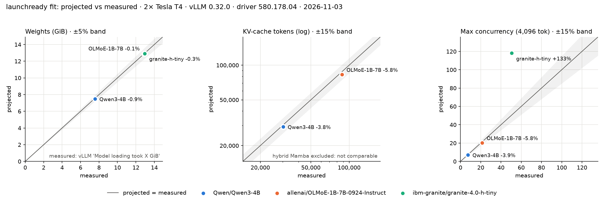

# LaunchReady

LaunchReady is a small, open-source kit that helps you find out whether a new open-weight model will run on NVIDIA GPUs before you download it. It reads a model's `config.json` and safetensors headers from Hugging Face, never the weights, to project memory at BF16, FP8, NVFP4 and GGUF and which GPUs fit. It then tests those projections on real GPUs and runs published quickstarts word for word to see what breaks. The worked example is NVIDIA Nemotron 3.5 Lightning. Every number is labeled measured or projected, and the misses are published alongside the hits.

- **Live tool:** [https://huggingface.co/spaces/tanmaypathak4/launchready](https://huggingface.co/spaces/tanmaypathak4/launchready) (free CPU Basic, no login)
- **One-page summary:** [tanmaypathak18.github.io/launchready](https://tanmaypathak18.github.io/launchready/)
- **Repo:** [github.com/Tanmaypathak18/launchready](https://github.com/Tanmaypathak18/launchready)

## The problem

When a new open model drops, a developer has two questions: will it fit my GPU, and will the model card's commands work? Neither is easy to answer without spending the download and the GPU time first.

- **The name isn't the size.** Lightning is called 30B and stores 32.91B parameters ([brief](briefs/nvidia__NVIDIA-Nemotron-3.5-Lightning-30B-A3B-BF16.md)). Lightning files labeled Q4_K_M store about 6.1 bits per weight, not the 4.85 you'd plan for ([findings](#key-findings)).
- **Weights aren't the whole bill.** Each user also needs KV cache, hybrid models add Mamba state, and the serving engine takes its own share. That is the difference between "it loads" and "it serves 8 people."
- **Model cards drift.** A flag gets removed from an engine, or a recipe names a file that isn't in the repo. Three of the quickstarts we ran as written [stopped a first-time developer](#key-findings).
- **"Supported" can mean only "registered."** An architecture in an engine's registry doesn't prove every precision or feature works. Reading [36 developer threads](docs/requirements.md) on Lightning found files whose contents don't match their names, crashes on recipes as written, and kernels that return fluent but wrong output.

## What LaunchReady does

**1. Fit calculator.** `launchready fit` projects weights at each precision, memory per user, and maximum users on each GPU in [the catalog](launchready/data/gpus.yaml). The [Space](https://huggingface.co/spaces/tanmaypathak4/launchready) wraps the same code for people who don't use a terminal, and leads with a plain-English verdict. The code is in [`launchready/`](launchready/report.py).

**2. Model brief.** `launchready brief` writes a one-page summary of a model's architecture, projected hardware needs, engine support and quantized variants, with sources. The [Lightning brief](briefs/nvidia__NVIDIA-Nemotron-3.5-Lightning-30B-A3B-BF16.md) is the worked example, with its ecosystem impact and risks written by hand. `launchready radar` lists recent releases from a watchlist of organizations ([example](radar/2026-11-02.md)).

**3. Memory validation.** A [Kaggle notebook](notebooks/01_memory_validation.ipynb) compared projections with what vLLM reported on real GPUs for a dense, an MoE and a hybrid Mamba model. Raw results are [in a CSV](results/memory_validation.csv), with the [environment](results/environment.json) and [logs](results/logs).

**4. Readiness checklist and launch kit.** The [checklist](docs/readiness_checklist.md) grades Lightning on an RTX 5090 across 27 checks, each with its evidence and what would close it. The [recipes](recipes/nemotron-3.5-lightning/README.md) and [benchmark scripts](bench/run_matrix.py) are pinned and ready for that session. So far they have run only as a [dry run on T4 with a different model](results/dryrun_kaggle/README.md).

**5. Friction log and requirements.** The [friction log](docs/friction_log.md) records each break with its command, error and root cause, including our own bugs. The [requirements table](docs/requirements.md) groups developer threads by root cause and turns them into user stories with acceptance criteria and owners.

## How it works

### Reading a model without downloading it

`launchready` fetches `config.json` and model info from the Hub, and reads parameter counts by data type from the safetensors file headers through `huggingface_hub`. No weights are downloaded. It then normalizes the config into layers, attention heads, sliding windows, MoE fields and Mamba fields. If a config field looks architecture-related and can't be interpreted, the tool warns and names it instead of guessing.

### The memory formulas

All of these are projections. The code is in [`launchready/memory.py`](launchready/memory.py), and the reference is in [section 6 of the roadmap](docs/roadmap.md).

- **Weights:** parameters × bits per weight ÷ 8. Bits per weight are 16 for BF16, 8 for FP8, 4.5 for NVFP4, 8.5 for GGUF Q8_0 and 4.85 for GGUF Q4_K_M.
- **KV cache:** for each attention layer and each token, 2 × KV heads × head dimension × bytes per value (2 for FP16, 1 for FP8). Sliding-window layers stop growing at the window length. MLA layers use their compressed rank instead.
- **Mamba state:** hybrid models keep a fixed state per user for each Mamba layer, which doesn't grow with the conversation. If the config doesn't name its data type, the tool assumes float32 and says so.
- **Fit model:** usable memory = GPU memory × 0.90 − weights − 2 GiB. Maximum users = usable memory ÷ memory per user, rounded down. The 0.90 is vLLM's default `gpu_memory_utilization`, and the 2 GiB is a reserve for everything else.

`launchready fit` uses the projected weights above. `launchready brief` and the Space use the real Hub file size where a matching repo exists, because real files can be larger. A base repo's own files are ignored if they're more than 25% from the BF16 projection, since they probably aren't plain BF16.

### How engine support is checked

`launchready brief` makes shallow sparse clones of vLLM, SGLang, llama.cpp and Transformers, at the latest stable release and the default branch, and searches each engine's model registry. Each engine is reported as `release`, `main-only`, `not-found` or `unknown`, with the matching file and line ([code](launchready/engines.py)). This shows that an engine knows the architecture, not that every precision or feature works. The Space skips this check.

### How validation was done

We ran [the notebook](notebooks/01_memory_validation.ipynb) on Kaggle's free 2× Tesla T4 (driver 580.178.04, CUDA 13.0, vLLM 0.32.0). Each model started in vLLM at 4,096 tokens per request. Measured values came from vLLM's startup log: `Model loading took X GiB`, `Available KV cache memory`, `GPU KV cache size` and `Maximum concurrency`. Each CSV row records the model revision, GPU, driver, versions and date.

A separate Transformers measurement [crashed on our own bug](docs/friction_log.md#transformers-weight-measurement-crashed-for-every-model), so weights come from vLLM's load log. That fix has not been re-run on a GPU.

## Key findings

Results are from 2026-11-03 unless noted. Each number is tagged **measured** or **projected**.

### The math held up on standard models

Users at 4,096 tokens on 2× Tesla T4 with vLLM 0.32.0:

| Model | Type | Users, projected | Users, measured | Gap | Weights gap against measured |
|---|---|---:|---:|---:|---:|
| Qwen/Qwen3-4B | Dense | 7.12 | 7.41 | −3.9% | −0.9% |
| allenai/OLMoE-1B-7B-0924-Instruct | MoE | 20.22 | 21.47 | −5.8% | −0.1% |
| ibm-granite/granite-4.0-h-tiny | Hybrid Mamba | 118.08 | 50.58 | **+133%** | −0.3% |



Evidence: [CSV](results/memory_validation.csv), [environment](results/environment.json), [notebook](notebooks/01_memory_validation.ipynb).

### The hybrid Mamba model broke it

A team sizing granite-4.0-h-tiny from this projection would have expected more than twice the users the engine could hold. Two errors multiply:

- **Confirmed, ×1.72: less memory left for users.** vLLM's log shows 2.93 GiB per GPU measured against 5.04 GiB projected, because overhead beyond the weights was 3.70 GiB measured, not the 2 GiB the formula assumes.
- **Hypothesis, ×1.36: each user costs more.** The size is known, 124 MB measured against 92 MB projected. The cause isn't: how vLLM pages Mamba state is the likely reason, and it is not confirmed.

The tool now warns about this gap. It was not retuned from one model. Lightning is also a hybrid Mamba model, so its capacity projection carries the same risk. Evidence: [analysis](docs/friction_log.md#granite-40-h-tiny-serves-23-fewer-users-in-vllm-than-projected), [vLLM log](results/logs/ibm-granite__granite-4.0-h-tiny__vllm.log).

### Real files are bigger than the labels

- **NVFP4:** projected 17.24 GiB, against a measured 20.08 GiB file for Lightning (+16%). That is the file size on Hugging Face, read on 2026-11-02, not memory measured on a GPU. Evidence: [brief](briefs/nvidia__NVIDIA-Nemotron-3.5-Lightning-30B-A3B-BF16.md#hardware-requirements), [friction log](docs/friction_log.md#lightning-nvfp4-projection-is-16-below-the-real-nvfp4-repo).
- **GGUF Q4_K_M:** three Lightning files store a measured 6.19 ([bartowski](results/bench/gguf/bartowski__Lightning-Q4_K_M.json)), 6.14 ([unsloth](results/bench/gguf/unsloth__Lightning-UD-Q4_K_M.json)) and 6.08 ([AtomicChat](results/bench/gguf/AtomicChat__Lightning-Q4_K_M.json)) bits per weight, read from file headers. The tool's projected figure is 4.85 bits per weight, or 18.58 GiB against the measured 23.73 GiB bartowski file. `launchready fit` still uses 4.85.

### Three quickstarts broke when run as written

- **Qwen3-4B card, vLLM command:** fails on vLLM 0.32.0 with an unrecognized `--enable-reasoning` flag, exiting after a measured 30 s on 2× Tesla T4. Evidence: [log](results/quickstart_audit/1b_vllm.log), [write-up](docs/friction_log.md#qwen3-4bs-vllm-one-liner-fails-on---enable-reasoning-in-vllm-0320-quickstart-audit-1b-kaggle).
- **Qwen3-4B card, Python snippet on a 16 GB Mac:** offloads to disk with a one-line log notice and printed no answer before the 2,700 s cap (measured). The same snippet worked on 2× Tesla T4 in a measured 115 s. Evidence: [log](results/quickstart_audit/1a_mac_run2_with_accelerate.log), [write-up](docs/friction_log.md#qwen3-4b-quickstart-offloads-to-disk-on-a-16-gb-mac-and-doesnt-finish-in-45-minutes-quickstart-audit-1a-mac).
- **Lightning NVFP4 card, llama.cpp recipe:** asks for `:Q4_K_M`, but the official GGUF repo has no such file, so it exits after a measured 6 s. Evidence: [log](results/quickstart_audit/3b_lightning_llama_server.log), [write-up](docs/friction_log.md#lightnings-llamacpp-recipe-asks-for-a-q4_k_m-file-that-doesnt-exist-quickstart-audit-3b).

### The Lightning verdict: not ready yet

The [readiness checklist](docs/readiness_checklist.md) stands at 1 ready, 5 not ready and 21 unknown, out of 27 checks. Those are counts from evidence in the repo, not hardware measurements, and the one ready item is a document check. Most of the unknowns remain because nothing has been measured on a 5090.

## Who it helps, and how

### Developers and local-model users

Use the Space or `launchready fit` to rule out a GPU before a long download. Use `launchready brief` to see engine support and which quantized versions exist, with real file sizes. Read the warnings: they name what the tool couldn't interpret and where its numbers are known to run high.

### Model-enablement and launch teams

The method transfers even if the tool doesn't. Run the quickstarts as written, log each break with its root cause, group developer threads into requirements, and hold a launch to a checklist where a claim about running the model needs a measurement on the target GPU. The [Lightning checklist](docs/readiness_checklist.md), [friction log](docs/friction_log.md) and [requirements table](docs/requirements.md) are worked examples.

### Where it isn't better, and its limits

We have not compared LaunchReady with other calculators, so we make no claim that it's more accurate than any of them. If you want a rough size for a dense model, a simpler estimate may be all you need. Its limits:

- **Memory only.** It says nothing about speed or answer quality.
- **One GPU, NVIDIA only.** The fit model covers a single GPU from a fixed catalog. It doesn't model multi-GPU serving, CPU offload or non-NVIDIA hardware.
- **vLLM-style assumptions.** The fit model follows vLLM. Other engines use memory differently.
- **Hybrid models run high.** The one hybrid measured missed by +133%, and the formula is not retuned.
- **GGUF sizes run low in `fit`.** It still uses 4.85 bits per weight. Use the brief or the Space, which prefer real file sizes.
- **Validated on three models.** They ran on Tesla T4 with one engine version, and the catalog's other GPUs are unmeasured.
- **Catalog caveats.** GPU capacity is the size on NVIDIA's spec pages read as GiB, except the T4's measured 15 GiB. B200 and DGX Spark carry `unverified` notes in [the catalog](launchready/data/gpus.yaml).
- **Gated repos.** The CLI needs your own `HF_TOKEN` for them. The Space has no login, so it can't read them.

## Quickstart

You need Python 3.11 or newer and [uv](https://docs.astral.sh/uv/). Run LaunchReady from a clone: `brief` loads its template from the repo.

```bash
git clone https://github.com/Tanmaypathak18/launchready.git
```

```bash
cd launchready
```

```bash
uv sync
```

Project memory and see which GPUs fit:

```bash
uv run launchready fit Qwen/Qwen3-4B --context 32768 --users 8
```

Write a brief to `briefs/`. It clones engine registries on first use and asks you to hand-write two sections:

```bash
uv run launchready brief Qwen/Qwen3-4B
```

List recent releases and write `radar/<date>.md`. Dates are Hub repo-creation dates, so use `--since 90d` for a wider look:

```bash
uv run launchready radar --since 30d
```

For gated repos, accept the license on Hugging Face and set `HF_TOKEN` in your environment.

### Reproduce a validation result

Print the projected and measured users from the committed CSV:

```bash
uv run python -c 'import csv; [print(r["repo_id"], r["label"], round(float(r["value"]), 2)) for r in csv.DictReader(open("results/memory_validation.csv")) if r["metric"] == "max_concurrency"]'
```

Then recompute the Qwen3-4B projection from the Hub with today's code. It prints the same KV budget as the CSV and 7.12 users:

```bash
uv run launchready fit Qwen/Qwen3-4B --context 4096 --gpu tesla-t4 --json | uv run python -c 'import json, sys; d = json.load(sys.stdin); f = d["fit"]["tesla-t4"]["bf16"]; print(f["kv_budget_bytes"], round(f["kv_budget_bytes"] / d["sequence"]["total_bytes"], 2))'
```

The CLI itself rounds down to 7 users and marks BF16 as not supported on T4, which runs FP16 at the same size. This reproduces the projection only. Qwen3-4B ran on one GPU, while the other two models ran across two, which the CLI doesn't model. Reproducing the measured values means rerunning [the notebook](notebooks/01_memory_validation.ipynb) on Kaggle.

## Measured vs projected, and what isn't done

**Measured:**

- Memory on 2× Tesla T4 ([environment](results/environment.json)).
- GGUF headers and Hugging Face file sizes, read without a GPU.
- Quickstart audits on Kaggle 2× T4 and a MacBook Air M4 with 16 GB ([results](results/quickstart_audit)).

**Projected:**

- Everything about Lightning running on an RTX 5090. With vLLM: 20.08 GiB of weights, 0.28 GiB per 40,960-token conversation and about 18 conversations ([table](recipes/nemotron-3.5-lightning/README.md#memory-on-a-32-gib-rtx-5090-projected)).
- With a GGUF file: about 6.0 GiB left with 8 slots, from a 23.73 GiB file ([table](recipes/nemotron-3.5-lightning/ollama.md#memory-projected)).

**Not done yet:**

- **The RTX 5090 run is deferred.** Lightning has not been run on a 5090, so there is no speed, memory or quality number from one, and the launch kit's headline benchmarks don't exist yet.
- **The kit is dry-run only.** It has run on Tesla T4 with Qwen3-4B, not Lightning. Those outputs prove the scripts run and are [not headline results](results/dryrun_kaggle/README.md).
- **Dry-run fixes are confirmed on T4 only**, not on Lightning, and the status for lost requests has never triggered on a GPU.
- **Some checks aren't covered by the planned session:** chat template, tool calling, a long soak run and a tokenizer comparison ([list](docs/readiness_checklist.md#not-tested-by-the-5090-session)).
- **The quality bar isn't set, and nothing is filed upstream yet**, including the Lightning card fix.

## Repo layout

| Path | What's there |
|---|---|
| [`launchready/`](launchready) | The CLI and library: Hub access, config parsing, memory math, engine checks, briefs, radar, GPU catalog |
| [`space/`](space) | The Gradio app behind the live tool |
| [`briefs/`](briefs) | Generated model briefs |
| [`radar/`](radar) | Release digests |
| [`recipes/`](recipes) | Pinned Lightning recipes for vLLM and Ollama |
| [`bench/`](bench) | Benchmark, quality and GGUF scripts and matrices |
| [`notebooks/`](notebooks) | Validation, quickstart audit and dry-run notebooks |
| [`results/`](results) | Raw measured results, logs and saved evidence |
| [`docs/`](docs) | Checklist, requirements, friction log, roadmap, progress and the summary page |
| [`scripts/`](scripts) | `check_site.py`, the link and banned-text guard |
| [`templates/`](templates) | The brief template |
| [`tests/`](tests) | Offline tests with saved fixtures |

## Contributing

To report a bad number, a broken command or a model the tool misreads, [open an issue](https://github.com/Tanmaypathak18/launchready/issues). Include the repo id, the command and its output.

For a code change, run these first. Tests use saved fixtures and can't reach the network:

```bash
uv run pytest
```

```bash
uv run ruff check .
```

```bash
uv run ruff format --check .
```

```bash
uv run python scripts/check_site.py
```

Please keep to the project's rules: label every number measured or projected, warn rather than guess when a config field can't be interpreted, never download weights in the calculator, and keep secrets out of git. If something breaks, add it to the [friction log](docs/friction_log.md) before fixing it.

## License

Apache-2.0. See [LICENSE](LICENSE).
